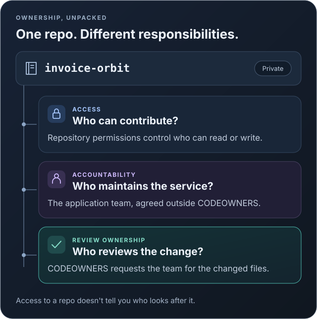
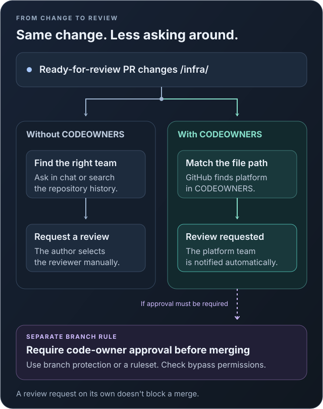
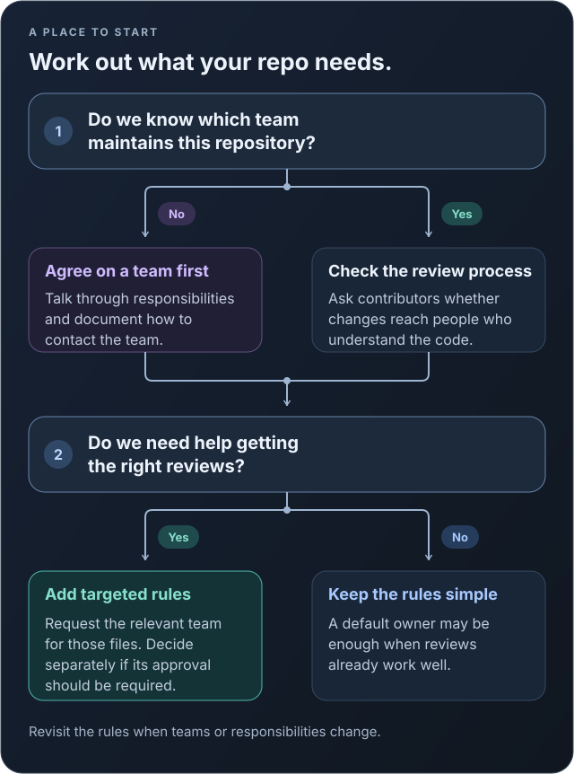

Suppose someone opens a pull request to change the infrastructure behind an application. They know several teams work in the repository, but they don't know which one to ask for a review. So they post a link in a team chat and wait.

Making the repository private hasn't helped with that question. It limits who can see the code, but everyone with access can still be unsure who looks after it.

Would a `CODEOWNERS` file help? Yes, with finding reviewers. I'd be more careful about calling it a solution to repository ownership, though. There are responsibilities it simply doesn't cover.

## Who owns the repository?

Let's use a private repository called `invoice-orbit`, a fictional company's billing service, as an example. The application team maintains the service, and the platform team helps with its infrastructure.

When we say a team "owns" this repository, we could mean a few things:



The application team might be responsible for dependency updates, production problems, and deciding when the service needs work. That needs agreeing with the team and recording somewhere people can find it, whether that's a README or a service catalog.

Reviewing a change is a narrower responsibility. The platform team may be the right people to review `/infra/` without taking over maintenance of the whole application.

That's the part I'd put in `CODEOWNERS`. Adding the platform team there shouldn't come as a surprise to them, and it shouldn't be the only conversation about what they're expected to do.

## What does CODEOWNERS actually do?

A `CODEOWNERS` file lists file patterns alongside GitHub users or teams. When a non-draft pull request changes matching files, GitHub requests their review. For a draft pull request, it waits until the author marks it ready for review.

In `invoice-orbit`, we can use that to send infrastructure changes to the platform team. The author doesn't need to know the team beforehand.



There's a catch here: the review request alone doesn't prevent a merge.

If we want owner approval to be required, we also need a branch protection rule or ruleset configured for the target branch. Check who can bypass those rules, too, especially if the intention is that nobody should merge without review.

Before setting this up for private organization repositories, check the GitHub plan. Code owners for those repositories require **GitHub Team or GitHub Enterprise**. GitHub's [code owners documentation](https://docs.github.com/en/repositories/managing-your-repositorys-settings-and-features/customizing-your-repository/about-code-owners) lists the current availability.

## A small example

Here's what `.github/CODEOWNERS` could look like for `invoice-orbit`. The organization and team names are placeholders:

```text
# Default review ownership for the repository.
*                       @example-org/application

# Specialist review ownership for infrastructure.
/infra/                 @example-org/platform

# Review changes to the ownership rules themselves.
/.github/CODEOWNERS      @example-org/application
```

The teams need to exist and have write access to the repository. They must also be visible teams; it isn't enough for individual members to have access through some other route.

One detail is easy to miss: **the last matching pattern wins.** For a change only inside `/infra/`, GitHub requests the platform team, not the application team as well. The default rule doesn't get added to the more specific one.

If both teams should be listed for infrastructure, put them on the same line:

```text
/infra/                 @example-org/application @example-org/platform
```

Even then, the standard code-owner review requirement doesn't require approval from both teams. Either listed owner can satisfy it for those files. If your policy says both teams must sign off, this line alone won't enforce that.

GitHub also reads the file from the pull request's **base branch**, meaning the branch the changes will merge into. To use these rules for pull requests targeting `main`, the file needs to be on `main`.

## Does every repository need one?

If several teams contribute to a repository, or people regularly ask who should review a change, I'd add one. It's also useful when a particular area needs specialist knowledge, such as deployment configuration or authentication code.

A new contributor benefits from this even if everyone else already knows who to ask. They can open a pull request without having to find the right person through a series of chat messages.



A small repository maintained by one team may not need much more than a default owner. If reviews already reach the right people, I wouldn't split ownership across every directory just to make the file look thorough. Someone will have to keep those rules up to date.

## What won't it solve?

It won't settle who responds to incidents or who has time to update an old dependency. Listing a team in a file doesn't give it the capacity to do the work.

It doesn't grant access either. Repository permissions still control who can read or change the code.

And the file can go stale. A team gets renamed, people move, or a service changes hands. Review requests may stop reaching anyone useful unless the ownership rules change as well.

There's also a cost to requesting too many reviews. If the platform team is named on every file in every repository, it gets pulled into changes it may not need to assess. That can slow reviews down rather than help.

I'd generally use a team rather than an individual's name when the responsibility belongs to that team. That makes staff changes easier to handle, provided someone keeps the team membership current.

## Rolling it out without creating a review backlog

I'd try this with a few actively maintained repositories before generating files across the organization.

For each one, agree who maintains it and which changes need another team's review. Start with those rules. Check team access and any errors GitHub highlights in `CODEOWNERS`, then test a few representative paths with pull requests after the file reaches the base branch.

Where owner approval is required, configure the branch rule and check bypass permissions. Include the `CODEOWNERS` file itself in the ownership rules, so changes to who gets requested are reviewed too.

Then give the teams time to use it. Are requests going to the right people? Are pull requests sitting around longer? Those answers are more useful than knowing every repository now has the file.

## My recommendation

For an organization with several teams sharing private repositories, I'd usually add `CODEOWNERS`. It saves contributors from guessing who should review their changes, and it gives us something concrete to use when owner approval needs to be required.

But I'd still want a clear answer to "who maintains this repository?" outside that file. For `invoice-orbit`, the application team remains responsible for the service even when the platform team reviews its infrastructure.

## References

- [GitHub: About code owners](https://docs.github.com/en/repositories/managing-your-repositorys-settings-and-features/customizing-your-repository/about-code-owners)
- [GitHub: About protected branches](https://docs.github.com/en/repositories/configuring-branches-and-merges-in-your-repository/managing-protected-branches/about-protected-branches)
- [GitHub: About rulesets](https://docs.github.com/en/repositories/configuring-branches-and-merges-in-your-repository/managing-rulesets/about-rulesets)
