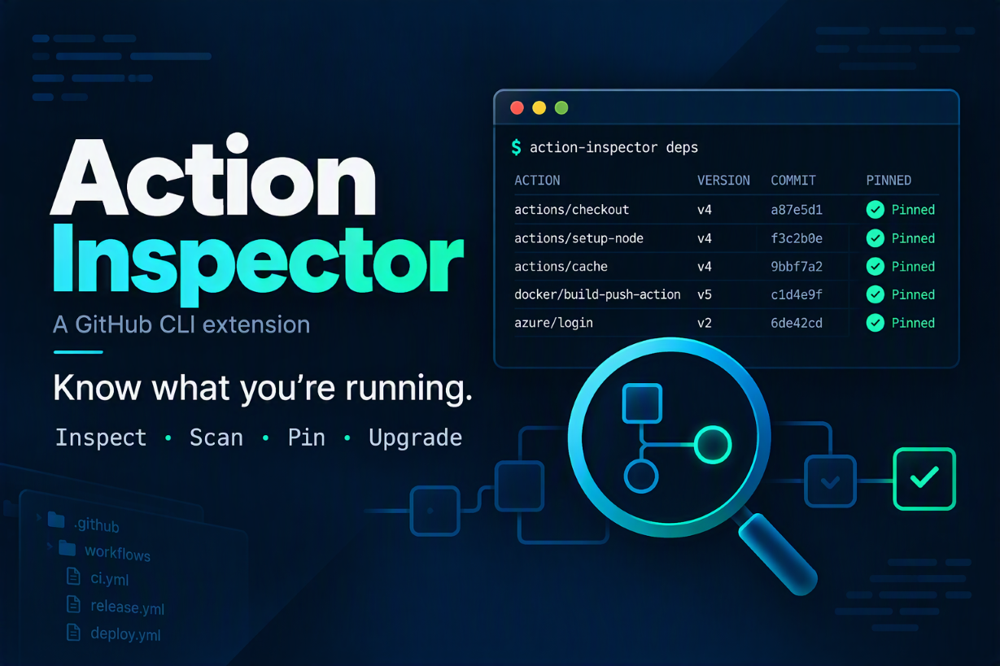

A GitHub CLI extension to inspect Actions, scan workflow dependencies, pin full commit SHAs, and preview upgrades with compatibility insights.

<!--more-->

[View LuanErasmus/gh-action-inspector on GitHub](https://github.com/LuanErasmus/gh-action-inspector).
